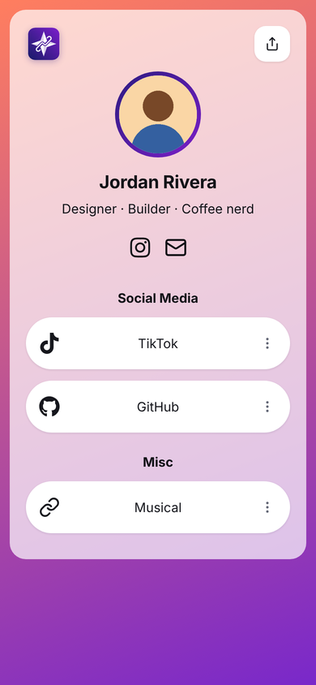
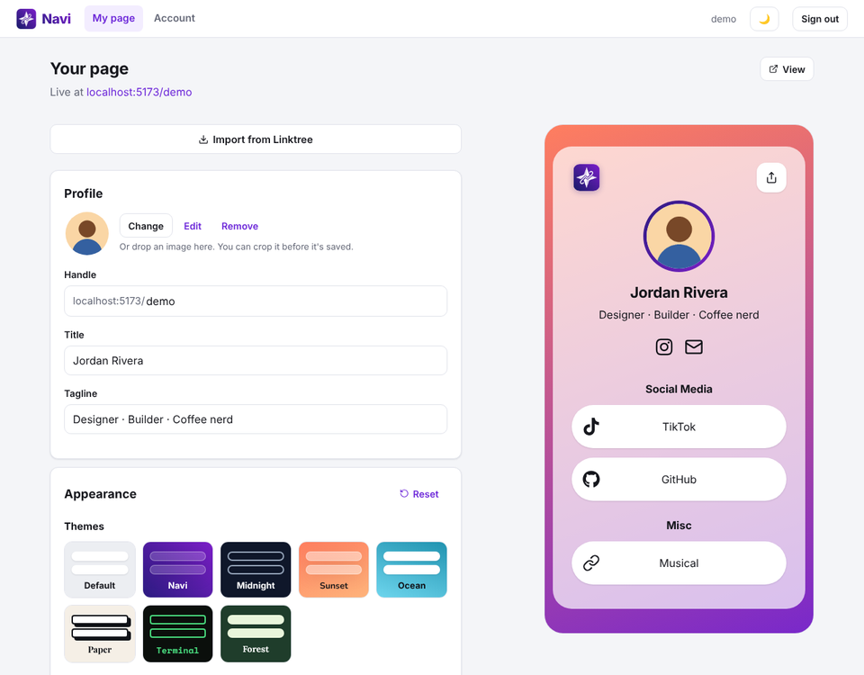

<p align="center">
  
</p>

<h1 align="center">Navi</h1>

<p align="center">
  <strong>One simple page for all of your important links.</strong><br>
  Self-hosted, open source, and yours.
</p>

<p align="center">
  <a href="https://github.com/zollo/navi/actions/workflows/ci.yml"></a>
  <a href="https://github.com/zollo/navi/releases"></a>
</p>

---

Navi gives everyone a single public page at `https://<your-navi>/<handle>`: a
photo, a name and tagline, a row of social icons, and link cards grouped under
headings. Sign up, claim a handle, add your links, and share one address
everywhere. You run it yourself, so your page and your data stay on your server.

<p align="center">
  
</p>

## Features

**Link pages**
- A clean, mobile-first page at `/<handle>` with your avatar, title, tagline,
  social icons and link cards.
- Organize links into sections with optional headings, in any order.
- Icons for popular services (Instagram, TikTok, YouTube, GitHub, Bluesky, Mastodon,
  Spotify, Discord and more), picked automatically from the URL you paste.
- A live preview while you edit, and a share button on every page.

**Import from Linktree**
- Paste your `linktr.ee` name and Navi pulls in your links, sections, social
  icons and photo as a draft. Review it, then save.

**Make it yours**
- Ready-made themes (Navi, Midnight, Sunset, Ocean, Paper, Terminal, Forest) as
  a starting point.
- Backgrounds: solid colors, gradients with any angle, your own uploaded image,
  or a picture from a gallery curated by the site's admins.
- A **content panel** behind your profile and links, in a solid color or
  gradient with adjustable opacity, so a busy background stays readable.
- Fonts, text color, and button style (filled, outline, glass, shadow) and
  shape (square, rounded, pill).
- **Avatar borders**: a solid or gradient ring around your photo, any width,
  on a circle, rounded or square avatar.
- Text color is picked automatically for readability unless you set it.

**Avatars that just work**
- Crop, zoom, rotate and flip your photo in the browser. Any image your browser
  can open (including HEIC on Safari) is resized and compressed before upload.

**Custom domains**
- Show your page on your own domain, like `links.example.com`. Add two DNS
  records, click verify, and Navi takes care of the rest. Domains are re-checked
  regularly and switched off if the DNS goes away.

**Safe by default**
- Links must be `https://`, `http://` or `mailto:`, and open with
  `rel="noopener noreferrer nofollow"`.
- Uploads are checked (PNG, JPEG, WebP, GIF; no SVG) and size-limited.

<p align="center">
  
</p>

## Self-hosting

Navi is a FastAPI backend, a React app served by nginx, and Postgres. Images are
published to GHCR as `ghcr.io/zollo/navi-backend` and `ghcr.io/zollo/navi-frontend`
for every release.

### Docker Compose (quickest)

```bash
git clone https://github.com/zollo/navi.git && cd navi
make up          # copies .env.example to .env if missing, then docker compose up --build
```

Open http://localhost:8080, choose **Create your page**, and claim a handle.

Before exposing it to the internet, edit `.env` and at least set:

| Setting | What it does |
|---|---|
| `SECRET_KEY` | Signs sign-in sessions. Use a long random string (`openssl rand -hex 32`). |
| `POSTGRES_PASSWORD` | Database password. Set it before the first start. |
| `NAVI_PUBLIC_URL` | The address people use, e.g. `https://links.example.com`. Pages live at `<NAVI_PUBLIC_URL>/<handle>`. |
| `ALLOW_REGISTRATION` | `false` stops new sign-ups once your own accounts exist. |
| `ADMIN_EMAILS` | Comma-separated emails that become admins and can curate the background gallery. |
| `LINKTREE_IMPORT_ENABLED` | Turn the Linktree import on or off. |
| `MAX_AVATAR_KB`, `MAX_BACKGROUND_KB` | Upload size limits. |
| `CUSTOM_DOMAINS_ENABLED` | Let users attach their own domains (see below). |

Every option is documented in [`.env.example`](.env.example). The frontend
proxies `/api` to the backend, so only one port needs to be published.

### TrueNAS SCALE

[`deploy/truenas/`](deploy/truenas/) has a compose file that uses the prebuilt
images and keeps Postgres on a dataset you can snapshot. See its
[README](deploy/truenas/README.md).

### Kubernetes (Helm)

```bash
helm install navi oci://ghcr.io/zollo/charts/navi --version <release>
```

The chart runs database migrations on start, scales the backend horizontally,
and with `customDomains.enabled` adds a job that verifies custom domains and
creates an Ingress (with TLS via cert-manager) for each one. See
[`charts/navi/values.yaml`](charts/navi/values.yaml).

### Custom domains

Set `CUSTOM_DOMAINS_ENABLED=true` and `CUSTOM_DOMAIN_TARGET` to the hostname
users should point at. A user then adds, for their domain:

- a TXT record `_navi-challenge.<domain>` with the token shown in the editor, and
- a CNAME to your target (or an A record to `CUSTOM_DOMAIN_IPS` for an apex domain).

Navi verifies these over public DNS. Routing and TLS for verified domains are
up to your reverse proxy, or automatic with the Helm chart.

### Admins

Admins can manage the curated background gallery at `/admin`. Grant the role
with `ADMIN_EMAILS`, or from the backend container:

```bash
python -m app.manage admin you@example.com            # add --revoke to remove
```

## API

Everything the web app does goes through a REST API under `/api`. Interactive
docs are served at `/docs`, and the OpenAPI spec is in
[`docs/openapi.json`](docs/openapi.json) and attached to each release.

## Development

```bash
cd backend && pip install ".[dev]" && ruff check . && pytest -q
cd frontend && npm install && npm run build && npm test
```

See [CLAUDE.md](CLAUDE.md) for commands and architecture notes, and
[CONTRIBUTING.md](CONTRIBUTING.md) for branching and PR-title rules (squash
merges, Conventional Commits drive the release version). Longer design notes,
the data model and the roadmap live in
[Notion](https://app.notion.com/p/4221d6dd324881f9bc57f5611fb8bfb7).

**Stack:** FastAPI · SQLAlchemy 2 (async) · Alembic · Postgres · React + Vite +
TypeScript · nginx · Docker Compose · Helm
